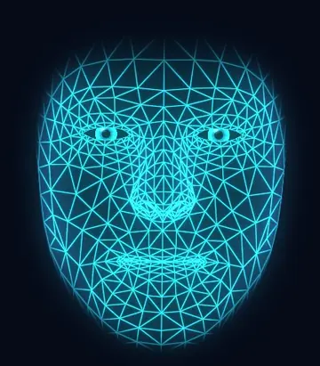
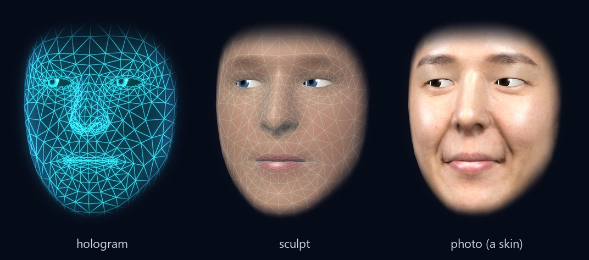
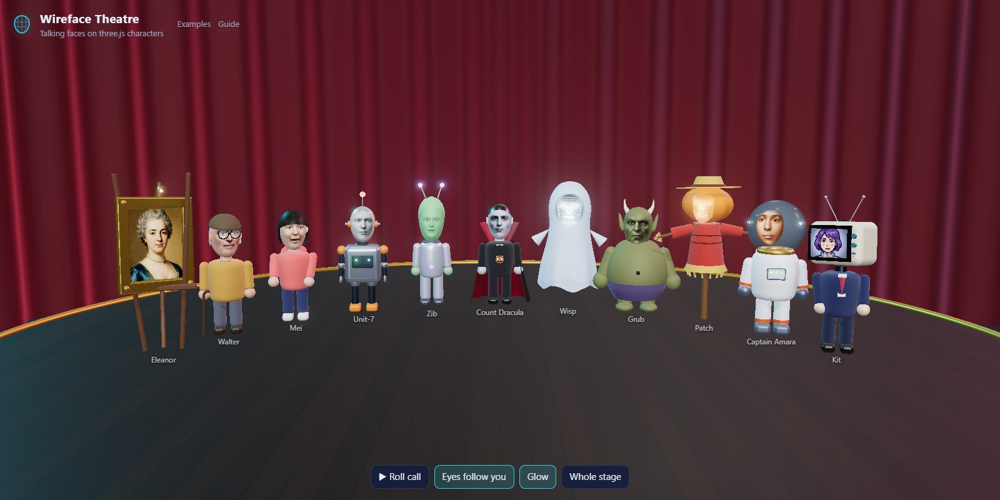

<p align="center">
  
  
</p>

<h1 align="center">Wireface SDK</h1>

<p align="center">
  Talking, lip-synced faces for the web.<br>
  A 3D face on a canvas &middot; any picture of a face brought to life &middot; faces for three.js characters.<br>
  Expressions, teeth, and lip sync from recorded clips, live audio or streamed speech. <b>No dependencies.</b>
</p>

<p align="center">
  <a href="#install">Install</a> &middot;
  <a href="#quick-start">Quick start</a> &middot;
  <a href="#guides">Guides</a> &middot;
  <a href="examples/">Examples</a> &middot;
  <a href="#licence">Licence</a> &middot;
  <a href="https://wireface.dev">wireface.dev</a>
</p>

---

This is the face engine from [Wireface](https://wireface.dev), the app that gives AI agents a face and a voice, as one
package you can build into anything: an assistant, a game character, a kiosk, a call-centre screen. Faces are made
for you from a face mesh, a photo or a picture, with no rigging or training, and run entirely in the browser.

| Import | What it is | Guide |
| --- | --- | --- |
| `@wireface/sdk` | A 3D face on a `<canvas>`: a glowing wireframe, a sculpted head, or a photo skin | [3D faces](docs/guide.md) |
| `@wireface/sdk/2d` | Any picture of a face, brought to life: photos, paintings, anime, pixel art, clay | [2D faces](docs/2d.md) |
| `@wireface/sdk/three` | Faces on the heads of three.js characters, as real geometry or a live texture | [three.js](docs/three.md) |

Plus `@wireface/sdk/config` and `@wireface/sdk/2d/config` (settings, safe to use in Node), `@wireface/sdk/2d/live`
(Gemini Live conversations), `@wireface/sdk/2d/server` (the server side of 2D, for Node 18+),
`@wireface/sdk/three/characters` (a [cast](docs/characters.md) of eleven ready-made characters) and
`@wireface/sdk/three/kit` (what they're built from).

## Install

**With npm**, from GitHub:

```sh
npm install github:compsmart/wireface-sdk#v0.1.0
```

```js
import { createFace } from '@wireface/sdk';
```

**With no build step**, straight from a CDN:

```html
<script type="module">
  import { createFace } from 'https://cdn.jsdelivr.net/gh/compsmart/wireface-sdk@v0.1.0/dist/wireface.js';
</script>
```

**Or host it yourself:** each [release](https://github.com/compsmart/wireface-sdk/releases) has a zip with
everything in it.

Pages must be served over http(s), because browsers don't load ES modules from `file://`. With a bundler (Vite,
webpack, Rollup, esbuild), copy `assets/` into your static folder and tell the face where it is: see
[Bundlers](docs/guide.md#bundlers).

TypeScript types are included.

## Quick start

### A 3D face

```html
<canvas id="face" style="width: 480px; height: 520px"></canvas>
<script type="module">
  import { createFace } from '@wireface/sdk';

  const face = createFace(document.getElementById('face'));
  await face.useSkin('dracula', { sweep: 1.6 });     // scans down onto the wireframe
  face.express('amused');

  const audioContext = new AudioContext();            // make or resume it in a click handler
  await face.say(await face.clip('dracula'), { audioContext });   // lip-synced
</script>
```



### Any picture

```js
import { createFace2d } from '@wireface/sdk/2d';

const face = createFace2d(document.querySelector('canvas'));
await face.useCharacter('sora');                     // a ready-made character...
await face.useCharacter(file);                       // ...or any picture: the face is found, then it comes to life
face.express('happy');
await face.say(await face.clip('sora'), { audioContext });
```


### three.js

```js
import { FaceMesh, attachFace } from '@wireface/sdk/three';

const face = new FaceMesh({ skin: 'mei', size: 0.27 });
attachFace(character.head, face);                    // it nods and sways that head as it talks
face.gazeAt(camera);
face.express('happy');
await face.say(await face.clip('mei'), { audioContext });
```

three.js is a peer dependency: install it yourself (0.160 or later). With no build step, map it in an import map:

```html
<script type="importmap">
{ "imports": {
  "three": "https://cdn.jsdelivr.net/npm/three@0.186.1/build/three.module.js",
  "three/addons/": "https://cdn.jsdelivr.net/npm/three@0.186.1/examples/jsm/",
  "@wireface/sdk/three": "https://cdn.jsdelivr.net/gh/compsmart/wireface-sdk@v0.1.0/dist/three.js"
} }
</script>
```



## Guides

- **[3D faces](docs/guide.md)**: looks, skins, skins from photos, teeth, expressions, talking, config files, events,
  recipes.
- **[2D faces](docs/2d.md)**: characters, finding faces in your own pictures, fitting by hand, the look, teeth,
  conversations, the server side.
- **[three.js](docs/three.md)**: FaceMesh and FaceScreen, putting a face on a head, gaze, speech, looks, building
  characters.
- **[The cast](docs/characters.md)**: the ready-made three.js characters.

See them all running at [wireface.dev](https://wireface.dev): the [3D playground](https://wireface.dev/try/),
[2D](https://wireface.dev/2d/try/) and the [three.js theatre](https://wireface.dev/threejs/demo/).

## Examples

[`examples/`](examples/) has small pages, one feature each, for 3D, 2D and three.js. To run them:

```sh
git clone https://github.com/compsmart/wireface-sdk.git
cd wireface-sdk
npm install          # three.js, for the three.js examples
npm start            # http://127.0.0.1:5173/examples/
```

The 2D examples that find faces, hold conversations or draw new characters need a Gemini API key: put
`GEMINI_API_KEY=...` in a `.env` file next to `package.json`. It stays in the dev server.

## What's in here

| | |
| --- | --- |
| `dist/` | the SDK: ES modules, minified, sharing one engine between the entries |
| `assets/` | ready-made skins and voices (3D), characters and voices (`assets/2d/`) |
| `types/` | TypeScript types for every entry |
| `face.schema.json`, `face2d.schema.json` | JSON Schemas for config files |
| `docs/` | the guides |
| `examples/` | the examples |

## Licence

Free for personal and non-commercial use, under the [PolyForm Noncommercial License 1.0.0](LICENSE.md).

Using it at work, for clients, or in a product or service you sell needs a **commercial licence**, which also gives
you the full source code: see [wireface.dev/license](https://wireface.dev/license/). Some parts come from other
projects and keep their own licences: see [NOTICE](NOTICE).

Bugs and questions: [GitHub issues](https://github.com/compsmart/wireface-sdk/issues).

Required Notice: Copyright 2026 Compsmart (https://wireface.dev)
