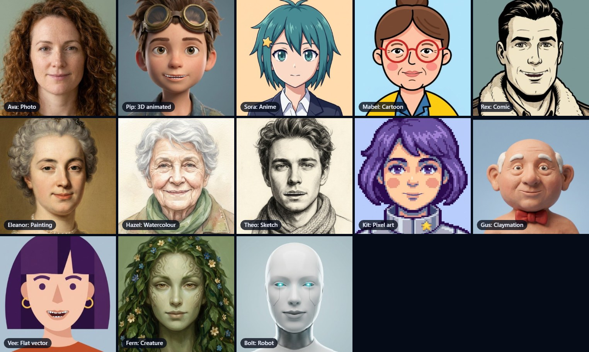
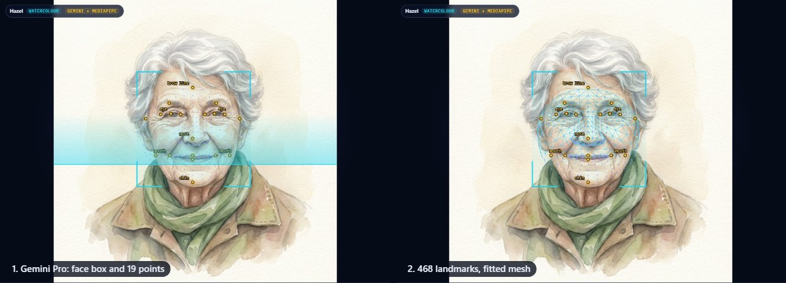
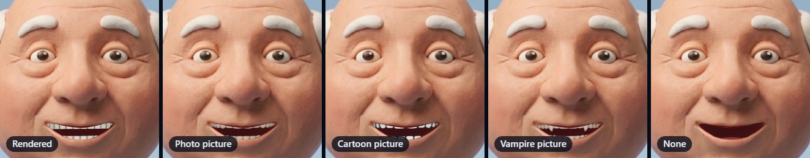
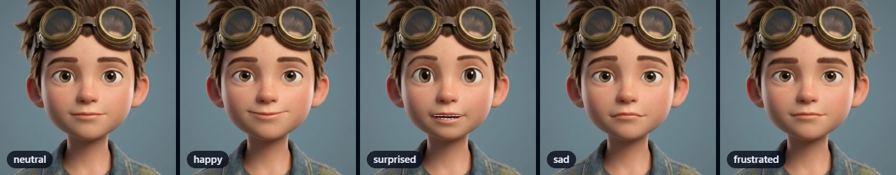

# Wireface SDK: 2D faces

Give it a picture of a face, a photo, a painting, anime or pixel art, and it talks. Gemini Pro finds the face,
MediaPipe adds dense landmarks where it can, and a 468-point mesh is fitted over it. The [3D face](guide.md)'s rig and
animator then drive that mesh, with the same expressions, blinks, gestures and lip sync, and the picture moves with it:
the mouth opens onto teeth, the eyes blink, the brows lift. The method names match the 3D face's, so the same code
drives either. For working code, see `examples/2d/`; to try it, see the [playground](https://wireface.dev/2d/try/).

1. [Install](#1-install)
2. [Your first face](#2-your-first-face)
3. [Characters](#3-characters)
4. [Finding faces](#4-finding-faces)
5. [The look](#5-the-look)
6. [Teeth](#6-teeth)
7. [Expressions, moods and states](#7-expressions-moods-and-states)
8. [Talking](#8-talking)
9. [Conversations](#9-conversations)
10. [Servers and secrets](#10-servers-and-secrets)
11. [Config files](#11-config-files)
12. [Events](#12-events)
13. [Recipes](#13-recipes)
14. [Under the hood](#14-under-the-hood)
15. [Troubleshooting](#15-troubleshooting)

## 1. Install

The 2D face comes with the SDK, as plain ES modules:

```sh
npm install github:compsmart/wireface-sdk#v0.1.0
```

```js
import { createFace2d } from '@wireface/sdk/2d';
// or with no build step:
import { createFace2d } from 'https://cdn.jsdelivr.net/gh/compsmart/wireface-sdk@v0.1.0/dist/2d.js';
```

`@wireface/sdk/2d` also has `DetectionOverlay`, `StreamVoice` and `LiveLipSync`. The rest have entry points of their
own: `@wireface/sdk/2d/live` for conversations (section 9), `@wireface/sdk/2d/config` for config files (section 11) and
`@wireface/sdk/2d/server` for the server's API (section 10, Node 18+). To host the files yourself, see
[Install](guide.md#1-install) in the 3D guide.

Pages must be served over http(s). `npm start` in the SDK's folder runs a dev server with no dependencies, with the
examples at http://127.0.0.1:5173/examples/; any static server works for the library itself, and `/api/*` is only needed
to find faces with Gemini, talk, or draw characters (section 10). The dev server answers only at 127.0.0.1, localhost or
[::1] with its own port, and never serves a file or folder whose name starts with a dot (`.env`, `.git`).

### Bundlers

The 2D face finds its characters and voices in the SDK's `assets/2d/`, beside the bundles. Bundlers move modules
around, so tell the face where they are:

1. Copy `node_modules/@wireface/sdk/assets` into your public folder (for example `public/wireface/`).
2. Pass its 2D folder: `createFace2d(canvas, { assets: '/wireface/2d/' })`.
3. Vite only: keep the SDK out of dependency pre-bundling (`optimizeDeps: { exclude: ['@wireface/sdk'] }` in
   `vite.config.js`), as for the [3D face](guide.md#bundlers).

The teeth pictures and the microphone worklet stay with the bundle, found with `new URL(..., import.meta.url)`, which
webpack 5, Rollup and esbuild handle.

## 2. Your first face

```html
<canvas style="width: 480px; height: 480px"></canvas>
<script type="module">
  import { createFace2d } from 'https://cdn.jsdelivr.net/gh/compsmart/wireface-sdk@v0.1.0/dist/2d.js';
  const face = createFace2d(document.querySelector('canvas'));
  await face.useCharacter('pip');
  face.express('happy', 3);
</script>
```

The canvas is sized by CSS; the face fills it as `framing` says (section 5). It blinks, breathes, glances about and
turns a little towards the pointer on its own.

## 3. Characters

A character is a picture and where the face is in it: 468 landmarks, one per vertex of MediaPipe's face mesh, as
`[x, y]` from 0 to 1 (origin top left). Anything else is optional: a name, an art style, a voice, a persona.

### The catalogue

`assets/2d/characters/characters.json` lists the ready-made ones, whose faces were found ahead of time:

```json
{ "id": "sora", "name": "Sora", "style": "anime", "voice": "Leda", "persona": "You are Sora, ...",
  "greeting": "Oh, hello! I'm Sora.", "line": "Hello! I'm Sora...", "cues": [[0, "happy"], [0.35, "curious"]] }
```

Beside it, for each: `<id>.jpg` (768 px), `<id>-thumb.jpg` (192 px, centred on the face) and `<id>.json`, which holds
the landmarks plus the detection that found them (`keypoints`, `box`, `style`, `mode`, `source`, and a `trace` for
replaying it). Optional fields: `teeth` (a teeth style) and `teethMode`.

```js
const list = await face.catalogue();                   // with image, thumb, data and styleLabel filled in
await face.useCharacter('eleanor', { transition: 0.9 });
```

### Your own

Any picture: `useCharacter` finds the face first (section 4).

```js
const character = await face.useCharacter(file, { onStep: s => console.log(s.label, s.status) });
```

Or find it without wearing it, and wear it later:

```js
import { characterFromImage } from '@wireface/sdk/2d';
const c = await characterFromImage(file, { gemini: { endpoint: '/api/detect' } });
await face.useCharacter(c);
```

To keep one, save `characterData(c)` as JSON next to the picture; `{ image: url, landmarks }` wears it again with no
detection. To keep several in a catalogue of your own, make a folder laid out like the SDK's `assets/2d/`: a
`characters/` folder with a `characters.json` (entries like the one above) and, for each character, `<id>.jpg`,
`<id>-thumb.jpg` and `<id>.json` (its `characterData`). Pass the folder as `assets` and wear them by id.

### Art styles



`photo`, `render3d`, `anime`, `cartoon`, `comic`, `painting`, `watercolor`, `sketch`, `pixel`, `clay`, `vector`,
`creature`, `robot`, `other` (`ART_STYLES`). Gemini names the style when it finds a face. Each style
sets what the "auto" settings mean: how much the head turns in 3D, whether there's lighting, whether pixels stay
crisp, and which teeth suit it.

## 4. Finding faces



`detectFace(picture, options)` (also behind `useCharacter(picture)`, `face.detect()` and `characterFromImage`) runs in
steps and reports each one through `onStep({ id, label, status, detail, ms, data })`:

| step | |
| --- | --- |
| `prepare` | the picture is decoded (EXIF rotation honoured) and scaled to 1024 px at most |
| `gemini` | Gemini Pro finds the face: `data` has `box`, `points`, `style`, `yaw`, `mouthOpen`, `character` |
| `mediapipe` | MediaPipe's 468 landmarks, in the browser; again inside Gemini's box if it missed |
| `fit` | the two combined: `data` has the final `uvs` and the `mode` |

`status` is `active`, `done`, `skipped` or `failed`. Gemini and MediaPipe run at the same time.

The result: `{ canvas, width, height, uvs, landmarks, mode, source, style, keypoints, box, character, pose, mouthOpen,
trace }`. `mode` says how the mesh was fitted:

| `mode` | when | |
| --- | --- | --- |
| `dense` | MediaPipe found it and Gemini agrees | MediaPipe's landmarks, as they are |
| `fused` | they half agree (a drawn face) | MediaPipe's mesh bent onto Gemini's points |
| `keypoints` | only Gemini found it | the canonical face bent onto Gemini's points |
| `manual` | neither | the canonical face, centred: fit it by hand |

"Agree" is measured in eye distances; photos are trusted further than drawings.

### Options

```js
detectFace(picture, {
  gemini: { endpoint: '/api/detect' },        // a server that holds the key (section 10); or { apiKey } for local
                                              // development only; leave it out for MediaPipe alone
  mediapipe: { bundle, wasm, model },         // your own copies of MediaPipe's files (see MEDIAPIPE); false to skip
  onStep, signal,
});
```

Give `createFace2d` the same as `detect: { gemini: ..., mediapipe: ... }` and `useCharacter(picture)` uses them.

### What Gemini is asked

Gemini is asked for the single most prominent face: its box and nineteen named points (the eyes' corners and centres,
the brows, the forehead, the nose tip, the mouth's corners, the lips, the chin, the face's edges and the jaw), with
"left" and "right" meaning the picture's, never the character's own. It's also asked for the art style, how far the
face is turned, whether the mouth is open, and a character to talk as (a name, a one-line description, a persona, a
voice from Gemini Live's list, and a greeting). A mirrored answer is put right, and an impossible one (the mouth above
the eyes) is refused.

Models are tried in order until one exists for the key: `gemini-3.1-pro-preview`, `gemini-pro-latest`,
`gemini-2.5-pro` (`DETECT_MODELS`; the dev server reads `GEMINI_DETECT_MODELS`). A detection takes about 6 to 10
seconds.

### Showing it happen

`DetectionOverlay` (from `@wireface/sdk/2d`) draws each step over the picture: a scan line, the box drawing itself in,
the points popping in with labels, the landmarks, the mesh. It's plain SVG; colour it with `--wf-box`, `--wf-point`,
`--wf-dense` and `--wf-mesh`.

```js
const overlay = new DetectionOverlay(stage);          // stage: position: relative
overlay.place({ x, y, width, height });               // where the picture is, in css px
await face.useCharacter(file, { onStep: s => overlay.step(s) });
await overlay.replay(face.character.trace, face.view.character.uvs);   // play a saved detection back
```

### Fitting by hand

```js
const fit = face.editFit();          // shows the mesh
fit.points();                        // the six handles (eyes, nose, mouth corners, chin) in css px
fit.move(2, [x, y]);                 // drag one
fit.shift(dx, dy);                   // move the whole mesh
fit.shape({ scaleX: 1.1, scaleY: 0.95, rotation: 0.05 });
const uvs = fit.done();              // puts show_mesh back as it was
```

A fit belongs to the picture it was started on. Wearing another character, or starting another `editFit`, ends it:
its moves no longer change the face.

For a face that was found but fitted a little off, `face.editFit({ handles: ANCHORS })` makes all 19 named points
handles instead (eye corners and centres, brows, forehead, nose, mouth corners, lips, chin, cheeks, jaw). The ones left
alone hold the rest of the face still, so moving one bends only the area around it. To keep a correction, save the
character with its new fit: `characterData({ ...face.character, uvs })`, with the `uvs` that `done()` returned.

### Good pictures

One face, roughly straight on (`character.pose.supported` is false past about 35 degrees), the whole face visible,
the mouth closed or nearly so (an open mouth is sealed shut and opened again by the rig, which works, but stretches
the lips). Hats and hair over the forehead are fine; hands or glasses over the eyes or mouth are not.

### Privacy

MediaPipe runs in the browser: the picture doesn't leave the page. Gemini detection sends it (scaled to 1024 px) to
your server, which sends it to Google. Say so wherever people upload pictures.

## 5. The look

| setting | |
| --- | --- |
| `framing` | `contain` shows all of the picture; `cover` fills the canvas (cropping); `face` closes in on the face |
| `zoom` | 0.5 to 3, about the face |
| `depth` | how far the head turns in 3D as it moves, 0 (flat) to 1; `auto` follows the art style |
| `shading` | `lit`: the face's lighting changes as it turns (relative to the picture's own, so at rest nothing changes); `flat`: none, for drawings |
| `smoothing` | `pixel` samples without smoothing, for pixel art |
| `edge_pin` | how firmly the face's outline holds to the picture behind it: higher keeps the jaw line and the chin where they are drawn |
| `feather` | how soft the face's edge is, in eye-widths |
| `motion` | idle head motion |
| `follow_mouse` | turn a little towards the pointer |
| `show_mesh` | draw the fitted mesh |

## 6. Teeth



The mouth opens onto a cavity (tinted from the character's lips, or `mouth_color`), a tongue, and teeth:

* `teeth_mode: 'rendered'`: modelled arches with gums. Lit for photos; for drawings (`shading` flat), white with drawn
  gaps.
* `teeth_mode: 'asset'`: a picture of teeth, `teeth_style` one of `TEETH_STYLES`: the 3D face's photographic `normal`,
  `braces`, `vampire`, `goofy`, `sharp`, `turkey`, or the drawn `anime`, `cartoon`, `comic`, `sketch`, `pixel`, `clay`.
* `teeth_mode: 'none'`.
* `auto` (both): what suits the art style, or the character's own `teeth`.

`teeth_width` and `teeth_size` (0.5 to 1.5) fit them to the mouth.

## 7. Expressions, moods and states



These are the [3D face](guide.md#6-expressions-moods-and-states)'s, unchanged:

```js
face.express('surprised', 3);         // show one for a few seconds: MOODS, or an everyday word ('scared')
face.mood('content', 0.6);            // worn whenever nothing else is: null for none
face.state('thinking');               // idle | thinking | busy | error | muted | asleep
defineExpression('wink', { blinkL: 1, smileL: 0.45, smileR: 0.3 });   // channels: CHANNELS
```

While it speaks, each sentence brings a light mood of its own ("sorry" looks concerned, "wow" surprised). On a flat
picture, the brow, cheek, mouth-corner and eye channels move about 1.3 to 1.6 times as far as on the 3D face,
because there's no shading to carry them; `expressiveness` scales everything.

## 8. Talking

```js
const audioContext = new AudioContext();                  // after a click
await face.say(await face.clip('ava'), { audioContext, onCaption: text => ... });
face.hush();
const stop = face.listenTo(audioContext, micStream);      // any audio as it plays
```

* **Recorded lines** (`assets/2d/voices/<id>.m4a` + `.json`) have a mouth track aligned phoneme by phoneme, so the lips
  close on every m, b and p. `assets/2d/voices/cast.json` holds each line's expression cues, in seconds. The tool that
  makes clips from your own audio comes with a [commercial licence](https://wireface.dev/license/); any audio works
  with streamed speech or `listenTo`, below.
* **Streamed speech**: `new StreamVoice(face, audioContext)` from `@wireface/sdk/2d`, `push()` 16-bit or float PCM
  as it arrives, `end()` when it's done. The mouth is worked out from each piece before it's heard.
* **Anything else**: `listenTo` reads loudness and spectrum as it plays (rougher; it can't look ahead).

## 9. Conversations

`Conversation` (from `@wireface/sdk/2d/live`) talks with the character through Gemini Live: the voice, the captions, the
expressions it asks for, interruptions, the microphone.

```js
import { Conversation } from '@wireface/sdk/2d/live';
const talk = new Conversation(face, {
  audio: () => audioContext,                            // or an async function that makes one on the first click
  character: () => ({ character: 'ava' }),              // what the token endpoint is asked for
  token: '/api/live/token',                             // the default
  onState: ({ state, detail, left, mic }) => ...,       // off | connecting | ready | thinking | speaking | ended | error
  onCaption: ({ who, text }) => ...,                    // who: 'face' | 'you'
});
await talk.start();                                     // greets in character
talk.send('Tell me about yourself');
await talk.setMic(true);
talk.changeFace('Sora');                                // after useCharacter: a new voice, the conversation carried on
talk.end();
```

### The token endpoint

POST `{ character: id }` (a catalogue character: the server uses its persona and voice) or `{ name, voice, persona }`
(your own), and answer `{ token, model, maxSeconds }`: a one-use Gemini Live token
(<https://ai.google.dev/gemini-api/docs/ephemeral-tokens>) locked to the whole session setup: model, persona, voice,
tools and transcription. The browser connects with `BidiGenerateContentConstrained?access_token=...`; whatever setup it
sends is ignored. `createApi` (section 10) does exactly this (taking the `persona` only with `customPersona: true`, as
the dev server does).

The model gets three tools: `express` (show a feeling for a few seconds), `go_away` and `come_back`.

For local development only, `new Conversation(face, { apiKey: () => key, character: () => ({ name, voice, persona }) })`
connects with a key directly and sends the setup itself. Never ship that.

## 10. Servers and secrets

`createApi` from `@wireface/sdk/2d/server` (Node 18+, no dependencies) answers:

| | |
| --- | --- |
| `POST /api/detect` | `{ image: base64, mimeType }` -> a detection |
| `POST /api/live/token` | `{ character }` or `{ name, voice, persona }` -> `{ token, model, voice, maxSeconds }` |
| `POST /api/generate` | `{ prompt, style }` -> `{ image: base64, mimeType }` |
| `GET /api/status` | `{ gemini, detectModels, liveModel, imageModels }`, never the key |

```js
import http from 'node:http';
import { createApi } from '@wireface/sdk/2d/server';
const api = createApi({
  key: process.env.GEMINI_API_KEY,
  hosts: ['example.com'], origins: ['https://example.com'],
  trustProxy: true,                                     // behind nginx, which sets X-Real-IP
  perDay: 50,
});
http.createServer(async (req, res) => {
  if (await api.handle(req, res)) return;
  // ...your own routes
}).listen(8080, '127.0.0.1');
```

Every POST must be `Content-Type: application/json` (415 otherwise) with a JSON object as its body (400 otherwise).
A request from another site, or to a host not in `hosts`, gets 403.

| option | default | |
| --- | --- | --- |
| `key` | | the Gemini API key; without it every route but `/api/status` answers 503 |
| `origins` | | the Origins that may call, like `['https://example.com']`. Without it, a request whose `Origin` isn't its own `Host` is refused. Requests with no `Origin` (not from a web page) are let through |
| `hosts` | | the `Host` headers it answers, like `['example.com']` or `['127.0.0.1:8080']`. Set it: it's what stops another site reaching the server through DNS rebinding |
| `customPersona` | `false` | take a persona from the browser for a character that isn't in the catalogue. Off, only a name and an allowed voice are taken. Turn it on only where the key is your own (the dev server does) |
| `perDay` | `300` | requests per client per route per day |
| `globalPerDay` | `1000` | requests per route per day from everyone together: a ceiling on the bill |
| `trustProxy` | `false` | behind a reverse proxy: the client is the address in `X-Real-IP`, or the last one in `X-Forwarded-For`. The proxy must set them; without it every visitor shares the proxy's count |
| `timeoutMs` | `90000` | how long a request may wait for Gemini. A call is also dropped when the browser goes away |
| `root` | the SDK's folder | where `assets/2d/characters/characters.json` is. If it isn't there, the token route answers 500 and logs where it looked |
| `maxSeconds` | `600` | the longest conversation |
| `detectModels`, `liveModel`, `imageModel` | | override the models |

### On a public server

Also:

* rate-limit `/api/*` in front (nginx `limit_req`, or your platform's), and cap the request size (about 1 MB is
  plenty for a 1024 px JPEG);
* give `createApi` your `hosts` and `origins`, and `trustProxy: true` if a proxy in front sets `X-Real-IP`;
* allow `wss://generativelanguage.googleapis.com` in your Content-Security-Policy's `connect-src`, and
  `'wasm-unsafe-eval'` in `script-src` for MediaPipe (plus the CDN, or host its files yourself);
* never put the key in a page, a URL, local storage or a repository. The dev server reads it from the environment or
  a git-ignored `.env`.

## 11. Config files

Every setting can live in a JSON file checked against `face2d.schema.json`:

```json
{ "$schema": "https://wireface.dev/schema/face2d.schema.json", "character": "sora", "framing": "face", "depth": 0 }
```

```js
face.set(validateConfig(await (await fetch('face.json')).json()));
```

`validateConfig` throws a `ConfigError` naming the setting and what's wrong; `configDiff(face.config)` gives what
differs from the defaults (what a file needs to say). A `character` in the patch is put on, and `face.config.character`
changes once it has loaded (an id that doesn't load leaves the one being worn); `character: null` changes nothing.

`$schema` gives editors such as VS Code autocomplete and checking: point it at the URL above, or at your copy
(`node_modules/@wireface/sdk/face2d.schema.json`). There are examples in `examples/2d/config/`. `validateConfig` and
`configDiff` come from `@wireface/sdk/2d/config`, and from `@wireface/sdk/2d` too.

## 12. Events

```js
const off = face.on(ev => {
  if (ev.type === 'speaking') console.log(ev.text === null ? 'stopped' : `saying: ${ev.text}`);
  if (ev.type === 'caption') console.log(ev.text);      // the sentence now reaching the speaker
});
```

## 13. Recipes

**An agent's face.** Pipe your agent's speech through `StreamVoice` (or `say` recorded clips) and call
`face.state('thinking')` while it works. Code written for the 3D face's `createFace` works as it is.

**React.** Make the face in an effect, keep it in a ref, `destroy()` on unmount:

```jsx
useEffect(() => {
  const face = createFace2d(ref.current);
  face.useCharacter(id);
  return () => face.destroy();
}, [id]);
```

`destroy()` stops the sound, any `listenTo`, and the drawing, and deletes what the face put on the GPU. The canvas
keeps its WebGL context, so a new face can be made on it straight away (as StrictMode does, mounting twice). A
character still loading when it's destroyed is never put on.

**Drawing over the face.** `face.project([u, v])` gives a picture point's place on the canvas; `face.view.vertices()`
gives the posed mesh in css px.

**Several faces.** Each canvas has its own WebGL context; browsers allow about 16 per page. A context goes when its
canvas does, so reuse canvases rather than making new ones for each face.

## 14. Under the hood

The 2D face runs the 3D face's rig and animator, and carries their movement onto the picture in proportion to the
picture's own face: a cartoon whose eyes are three times the usual height still blinks shut, and a wide mouth opens to
its own width.

An open mouth in the picture is closed first, because the rig expects closed lips, and the rig opens it again as the
face talks. The picture is drawn first and the face over it. Near the face's outline, movement fades out (`edge_pin`)
so the jaw line and chin stay where they're drawn, and the face's edge feathers into the picture (`feather`): at rest
both are the same picture, so no seam shows.

The inside of the mouth (the cavity, tongue and teeth) is drawn only within the mouth's opening, and turns with the
jaw. The eyes are the picture's own. The head turns in 3D about the neck, as far as `depth` says, so the nose moves more
than the cheeks, and `shading: 'lit'` shades only how the light has changed since rest, so a still face is exactly the
picture.

Finding a face asks Gemini and MediaPipe at once, and combines what they agree on (section 4).

## 15. Troubleshooting

| | |
| --- | --- |
| Blank canvas, "WebGL2 is not available" | an old browser, or WebGL off: try Chrome, Edge, Firefox or Safari 15+ |
| "the character list not found" | the `assets` URL is wrong: see [Bundlers](#bundlers) |
| No face found in a drawing | without Gemini only MediaPipe looks, and it misses most drawn faces: set `GEMINI_API_KEY` |
| The face slides off a turned head | the picture is too far from straight on (`character.pose`) |
| Lips look stretched | the mouth is open in the picture: one with the mouth closed animates better |
| A ghost of the chin | raise `edge_pin` or `feather` |
| "Gemini refused the conversation" | the key can't use the Live model: set `GEMINI_LIVE_MODEL` for the dev server, or `createApi`'s `liveModel` |
| No sound | browsers need a click before sound: make the `AudioContext` in a click handler |
| `/api/...` answers 503 | the dev server has no key: put it in `.env` and restart |
| `/api/...` or the dev server answers 403 | open the page at the server's own address (127.0.0.1 or localhost, with its port); on your own server, check `hosts` and `origins` |
