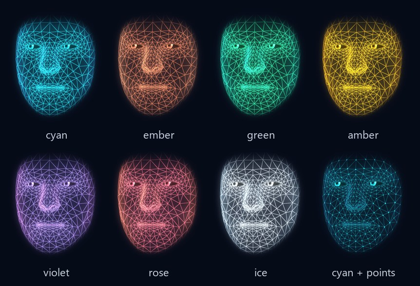
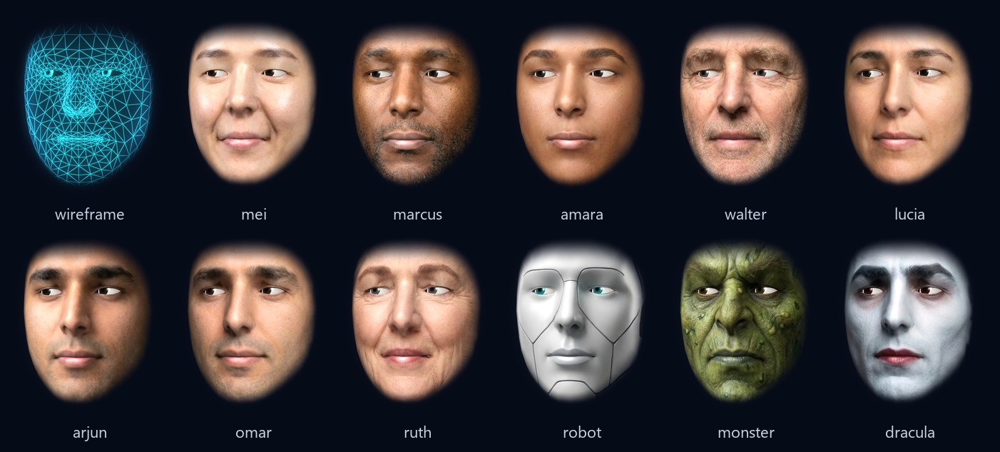
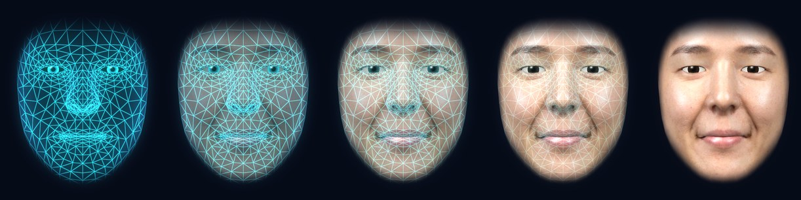
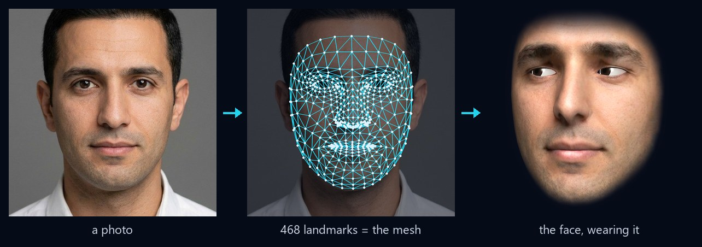
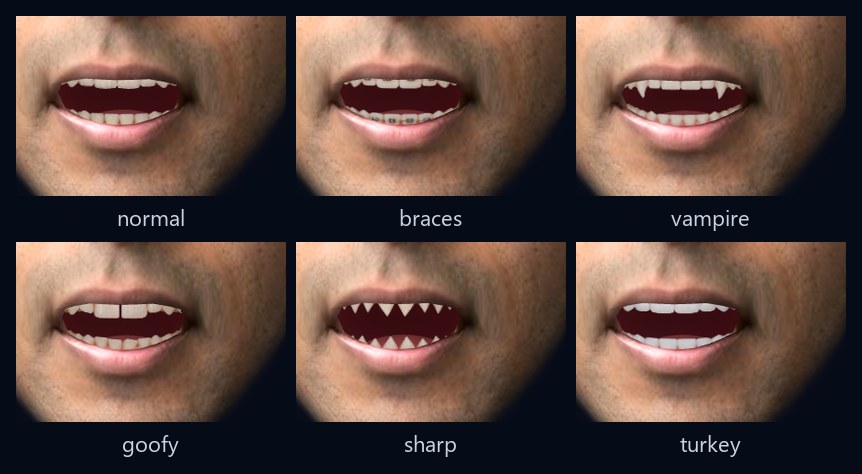

# Wireface SDK: 3D faces

This guide covers everything you need to put a talking face into a web page or app, from a first face to your own
skins, voices and expressions. For a quick look, start with the [README](../README.md). For working code, see
`examples/3d/`, one small page per topic. The SDK also brings any picture of a face to life
([2D faces](2d.md)) and puts faces on three.js characters ([three.js](three.md)).

- [1. Install](#1-install)
- [2. Your first face](#2-your-first-face)
- [3. Looks](#3-looks)
- [4. Skins](#4-skins)
- [5. Teeth](#5-teeth)
- [6. Expressions, moods and states](#6-expressions-moods-and-states)
- [7. Talking](#7-talking)
- [8. Config files](#8-config-files)
- [9. Events](#9-events)
- [10. Recipes](#10-recipes)
- [11. Under the hood](#11-under-the-hood)
- [12. Troubleshooting](#12-troubleshooting)

---

## 1. Install

The SDK is plain ES modules with no runtime dependencies. Pick whichever way of getting it suits your project.

**With npm**, from GitHub:

```sh
npm install github:compsmart/wireface-sdk#v0.1.0
```

```js
import { createFace } from '@wireface/sdk';
// or just the config checks:
import { validateConfig } from '@wireface/sdk/config';
```

**With no build step**, from a CDN:

```js
import { createFace } from 'https://cdn.jsdelivr.net/gh/compsmart/wireface-sdk@v0.1.0/dist/wireface.js';
```

**Self-hosted**: each release of the SDK on GitHub has a zip of `dist/`, `assets/`, `types/`, `examples/` and
`docs/`. Put `dist/` and `assets/` on your server side by side, as they are in the zip, and import `dist/wireface.js`.

**To run the examples**, clone the SDK. `npm start` in its folder serves them, and `npm install` first fetches three.js
for the three.js ones:

```sh
git clone https://github.com/compsmart/wireface-sdk.git
cd wireface-sdk
npm install
npm start          # http://127.0.0.1:5173/examples/
```

Everything for the 3D face is exported from `@wireface/sdk`, the expressions, skins and speech included;
`@wireface/sdk/config` has the config checks on their own. The skins and voices are under `@wireface/sdk/assets/*`, the
config schema is `@wireface/sdk/face.schema.json`, and `types/` has TypeScript types for every entry point.

Pages must be served over http(s), because browsers don't load ES modules from `file://`. `npm start` in the SDK's
folder serves the examples at http://127.0.0.1:5173/examples/; `npx serve`, `python -m http.server` or any web server
works too.

### Bundlers

The face finds its files relative to its own bundle (`new URL('../assets/', import.meta.url)`). Bundlers move modules
around, so tell the face where its assets are:

1. Copy the assets into your static folder, e.g. `node_modules/@wireface/sdk/assets` to `public/wireface/`. Add a
   `postinstall` script, or copy them once and commit them.
2. Pass that folder to the face:

   ```js
   const face = createFace(canvas, { assets: '/wireface/' });
   ```

3. Vite only: keep it out of dependency pre-bundling, or the teeth images go missing in dev:

   ```js
   // vite.config.js
   export default { optimizeDeps: { exclude: ['@wireface/sdk'] } };
   ```

Other bundlers (webpack 5, Rollup, esbuild) handle `new URL('./file.png', import.meta.url)` for the teeth images. The
same `assets` option applies to them. The 2D faces' files are in the same folder, under `2d/`: see
[2D faces](2d.md#bundlers).

If the assets aren't where the face looks, you get an error naming the URL it tried, e.g. `the skin list not found
at http://localhost:5173/node_modules/.vite/deps/assets/skins/skins.json (got a page, not JSON)`.

---

## 2. Your first face

```html
<canvas id="face" style="width: 480px; height: 520px"></canvas>
<script type="module">
  import { createFace } from 'https://cdn.jsdelivr.net/gh/compsmart/wireface-sdk@v0.1.0/dist/wireface.js';
  const face = createFace(document.getElementById('face'));
</script>
```

That gives you a glowing wireframe that blinks, breathes, glances about and follows the pointer.

**Sizing.** Size the canvas with CSS. The face draws at the canvas's CSS size, times the device pixel ratio (capped at
2). It follows resizes on its own and keeps its proportions, centred. `fit` sets how much of the canvas it fills
(0.5 to 1.2, default 0.9). The `zoom` setting does the same thing as part of the config.

**Background.** The canvas is transparent. Put a colour, an image or a video behind it. The presets come with a
matching background colour (`PRESETS.cyan.background`) if you want one.

**Options.**

```js
const face = createFace(canvas, {
  config: { preset: 'ember', skin: 'mei' },   // any settings (section 8); checked
  assets: '/wireface/',                        // where skins/ and voices/ are (default: the package's own)
  fit: 0.9,                                    // how much of the canvas the face fills
  follow: true,                                // eyes and head follow the pointer anywhere in the window
});
```

**Looking somewhere.** With `follow: false`, or whenever you like, point its gaze yourself. The arguments are CSS
pixels from the face's centre, with y pointing down. The face looks back to the front 4 seconds after the last call,
so call it again to hold a gaze:

```js
face.view.setPointer(-300, -50);    // looks to its left, slightly up
face.view.setPointer(null);         // straight ahead
```

**Pausing.** `face.pause()` stops drawing (and moving) until `face.resume()`. The face also rests by itself while
its canvas is scrolled out of view, and carries on when it's back, unless you paused it. A clip goes on playing while
it's paused, and the mouth is in step again when it resumes.

**Cleaning up.** `face.destroy()` stops the animation and any clip, removes its listeners and frees what it holds on
the GPU. Call it when the canvas goes away (for example, when a component unmounts). The WebGL context stays with the
canvas, so a new face can be made on the same canvas afterwards.

---

## 3. Looks


| setting | values | default | what it does |
| --- | --- | --- | --- |
| `style` | `hologram`, `sculpt`, `photo` | `hologram` | `photo` is what a skin is shown in; wearing a skin switches to it |
| `skin_amount` | 0 to 1 | 1 | wireframe (0) to skin (1): a cross-fade from the wireframe to the skin ([more](#wireframe-to-skin)) |
| `preset` | `cyan`, `ember`, `green`, `amber`, `violet`, `rose`, `ice` | | sets `colors.primary`, `secondary` and `background` |
| `colors.primary` | `#rrggbb` | `#22d3ee` | the wireframe and its glow |
| `colors.secondary` | `#rrggbb` | `#6366f1` | the rim light |
| `colors.background` | `#rrggbb` | `#060b18` | for your page to use; the canvas itself stays transparent |
| `colors.skin`, `colors.lips` | `#rrggbb` | | the sculpted head |
| `colors.iris` | `#rrggbb` | `#4f86c6` | eye colour |
| `colors.mouth` | `#rrggbb` | `#5c1018` | inside the mouth |
| `glow` | 0 to 2 | 0.6 | bloom around the lines (photo and sculpt use a tenth of it) |
| `wire` | 0 to 1 | 0.8 | wireframe line strength |
| `fill` | 0 to 1 | 0.3 | surface fill behind the lines |
| `scanlines` | 0 to 1 | 0.25 | hologram scanlines |
| `points` | 0 to 1 | 0 | dots on the vertices |
| `edge_fade` | 0 to 1 | 0.5 | soft edge around the face |
| `eyes` | true, false | true | eyeballs; false gives hollow hologram eyes |
| `zoom` | 0.5 to 2 | 1 | |



```js
face.set({ preset: 'amber' });
face.set({ colors: { primary: '#ff4d6d' }, glow: 1.4, scanlines: 0 });
face.config;                          // everything, as it is now
```

`set` takes any part of the config, checks it, applies it and returns the whole config. It throws a `ConfigError` for
anything unknown or out of range and changes nothing (`colors.primary: expected #rrggbb`, `glow: 3 is outside 0..2`).
`RANGES` holds the limits of every numeric setting, which is handy for building sliders, as the
[playground](https://wireface.dev/try/) does.

---

## 4. Skins



A skin is a picture of a face plus where the face's landmarks are in it. The face mesh is MediaPipe's canonical
face model, whose 468 vertices are the 468 landmarks MediaPipe finds in a photo. So once you know where the
landmarks fall in a picture, each one becomes its vertex's texture coordinate, and the picture becomes a 3D face
that blinks, looks around, smiles and talks. The eyes, teeth and inside of the mouth are drawn by the engine.

### Wearing one

```js
await face.useSkin('mei');                       // from the catalogue (assets/skins/skins.json)
await face.useSkin('dracula', { sweep: 1.6 });   // scan down onto the face over 1.6 s (the old skin comes off first)
await face.useSkin('robot', { teeth: 'sharp' }); // with other teeth than the skin's own
await face.useSkin(null);                        // back to the wireframe
```

`useSkin` resolves once the skin is showing. Until its picture has loaded, the skin that was on stays on (with a
sweep, it comes off while the new one loads). It also records the skin in the config (`face.config.skin`), with the
teeth that go with it. A sweep scans the skin down at the `skin_amount` it's set to (below).

If the picture or its landmarks can't be loaded, `useSkin` rejects with an error that says which, and the skin that
was on stays on, in the config too. When you call it again before it's done, the newer call takes over: the older one
resolves without putting its skin on. `face.set({ skin: 'mei' })` puts a skin on the same way, without waiting (it
logs a warning if the skin fails).

The ones included are `mei`, `marcus`, `amara`, `walter`, `lucia`, `arjun`, `omar`, `ruth`, `robot`, `monster`
and `dracula`. To list them:

```js
import { catalogue, ASSETS } from '@wireface/sdk';
const skins = await catalogue(ASSETS);   // [{ id, name, kind, teeth, image, thumb, landmarks }], with file URLs
```

### Wireframe to skin



`skin_amount` (0 to 1, default 1) is a cross-fade from the wireframe to the skin, over the whole face. 0 is the bare
wireframe and 1 the whole skin. In between, the skin fades in (a little ahead) as the wireframe's lines, points,
scanlines and rim fade out, and the eyes and the inside of the mouth blend from the hologram's to the skin's. It's a
setting like any other, so it applies to whichever skin is on (a catalogue one or your own) and it can go in a config
file.

```js
face.set({ skin_amount: 0.5 });     // half and half

// a slider, as in the playground: <input type="range" id="amount" min="0" max="1" step="0.01" value="1">
amount.oninput = () => face.set({ skin_amount: +amount.value });
```

A new value glides in over a second or so, so a slider can set it directly. Only the wireframe glows: its share keeps
its glow (`glow` and the other hologram settings apply to it), and the skin barely blooms (a tenth of the glow, as at
full skin). `useSkin(skin, { sweep })` still scans a new skin down the face, showing as much of it as `skin_amount`
says; at 0 there's nothing to see, so it switches at once. With no skin on, `style: 'sculpt'` fades in over the
wireframe the same way.

### From a photo, in the browser



```js
import { skinFromPhoto } from '@wireface/sdk';

const skin = await skinFromPhoto(file);          // a File, Blob or URL
// -> { image: Blob (JPEG, at most 1024 px), landmarks: [[x, y] x 468], width, height }
await face.useSkin(skin, { sweep: 1.4 });
```

This loads MediaPipe's face landmarker from a CDN the first time it's used (a few megabytes of WebAssembly and
model), and the photo never leaves the browser. To host MediaPipe yourself, pass your own paths. `MEDIAPIPE` holds the
defaults:

```js
await skinFromPhoto(file, { bundle: '/mp/vision_bundle.mjs', wasm: '/mp/wasm', model: '/mp/face_landmarker.task' });
```

It throws "couldn't find a face in that picture" when there isn't one.

**Good photos** are taken straight on, with the mouth closed and even light, and the face filling a good part of
the frame. It works on painted, rendered and AI-made faces too, robots and monsters included, as long as they're
face-shaped (that's how the robot, monster and Dracula skins were made).

### Your own skin files

A skin is two files: a picture and a JSON array of 468 `[x, y]` pairs from 0 to 1, with the origin at the top left
of the picture. `examples/3d/photo.html` makes them from a photo and saves them. Wear them directly:

```js
await face.useSkin({ image: '/faces/ada.jpg', landmarks: '/faces/ada.json', teeth: 'normal' });
// image: a URL, Blob or ImageBitmap (the face keeps its own copy); landmarks: a URL or the array itself
```

Or add them to a catalogue of your own: a folder with `skins/skins.json`, plus `ID.jpg`, `ID-thumb.jpg` and
`ID.json` for each skin:

```json
[
  { "id": "ada", "name": "Ada", "kind": "human", "teeth": "normal" }
]
```

```js
const face = createFace(canvas, { assets: '/my-faces/' });
await face.useSkin('ada');
```

An id is lowercase letters, digits, `-` and `_`, up to 40 characters. `kind` is free text (the included ones use
`human`, `robot` and `creature`). The thumbnail is only for pickers like the playground's.

---

## 5. Teeth



Photo skins show photographic teeth when the mouth opens. The styles are `normal`, `braces`, `vampire`, `goofy`,
`sharp` and `turkey`.

```js
face.set({ teeth_style: 'vampire', teeth_width: 1.1, teeth_size: 0.9 });   // width and size: 0.5 to 1.5
```

A catalogue skin brings its own teeth (`"teeth"` in `skins.json`). Teeth you name along with the skin win over them:
`useSkin(id, { teeth })`, `teeth_style` in the same `set()` call, or `teeth_style` next to `skin` in the config you
create the face with. Put a skin on without naming any, and it wears its own.

```js
face.set({ skin: 'robot' });                              // braces, the robot's own
face.set({ skin: 'dracula', teeth_style: 'goofy' });      // goofy
createFace(canvas, { config: { skin: 'robot', teeth_style: 'normal' } });   // normal
```

---

## 6. Expressions, moods and states


### Expressions

```js
face.express('surprised');        // eases in, holds for 4 s, eases back
face.express('happy', 10);        // for 10 s
face.express('angry');            // aliases work: this is 'frustrated'
```

The built-in expressions are `happy`, `excited`, `amused`, `surprised`, `curious`, `thinking`, `concerned`, `sad`,
`afraid`, `frustrated`, `calm`, `content`, `bored`, `glum` and `neutral` (all of them in `MOODS`). The aliases are
everyday words for them (`ALIASES`): smile, joy and glad mean happy; angry and annoyed mean frustrated; confused and
pondering mean thinking; scared and fear mean afraid; worried means concerned; and so on. An unknown name throws.

The `expressiveness` setting (0 to 2, default 1) scales how strongly every expression and gesture shows. The
pictures above use 2.

### Your own

An expression is a set of weights from 0 to 1 over the rig's channels:

```js
import { defineExpression, CHANNELS } from '@wireface/sdk';

defineExpression('wink', { blinkL: 1, smileL: 0.45, smileR: 0.7, browUpR: 0.3, squintL: 0.3 });
defineExpression('smug', { smileL: 0.6, smileR: 0.1, browUpL: 0.4, squintR: 0.3 });
face.express('wink');
```

| channels | |
| --- | --- |
| `jaw` | opens the mouth |
| `close`, `wide`, `round`, `upperUp`, `lowerDown`, `bite`, `pout` | lips |
| `smileL`, `smileR`, `frown`, `sneer`, `cheekPuff` | mouth corners and cheeks |
| `blinkL`, `blinkR`, `squintL`, `squintR`, `eyeWideL`, `eyeWideR` | lids |
| `browUpL`, `browUpR`, `browDown`, `browInner` | brows |

`L` and `R` are the face's own left and right (so `blinkL` closes the eye on your right as you look at it).
Expressions are shared by every face on the page. Defining one with an existing name replaces it.

### Moods

A mood is worn whenever nothing else is showing: a resting face.

```js
face.mood('content', 0.6);    // intensity 0..1
face.mood(null);              // none
```

### States

States show what the face, or the agent behind it, is doing. They change the eyes, posture and pace, not just the
mouth.

```js
face.state('thinking');   // eyes up and aside, while you wait for an answer
face.state('busy');       // working
face.state('error');
face.state('muted');
face.state('asleep');     // eyes close; 'idle' wakes it
face.state('idle');
```

For something the viewer has to wait on (a long job, an agent compacting its conversation), the eyes can say so:
they glow, the pupils widen and a spinner turns in them, and the face looks at the viewer. It fades in and out.

```js
face.spinner(true);
// ...
face.spinner(false);
```

---

## 7. Talking

There are two ways to drive the mouth:

| | clips | live |
| --- | --- | --- |
| for | speech you have in advance: recorded lines, TTS you generate first | speech as it happens: a microphone, a call, streaming TTS |
| how | a mouth track made from the audio and its words | loudness and spectrum, frame by frame |
| quality | best: lips close on m, b and p, round on "oo", in time | good, approximate |
| API | `face.say(clip)` | `face.listenTo(audioContext, source)` |

### Sound and autoplay

Browsers only allow sound after the user has interacted with the page. Create your `AudioContext` in a click
handler, or resume it there:

```js
let audioContext = null;
soundButton.onclick = () => { audioContext ??= new AudioContext(); audioContext.resume(); };
```

Without an `audioContext`, `say` still moves the mouth: the face mimes.

### Clips

```js
const clip = await face.clip('dracula');                // assets/voices/dracula.json (+ its audio)
await face.say(clip, {
  audioContext,                                         // optional: heard as well as seen
  onCaption: text => (caption.textContent = text),      // the words so far, as they're spoken
});
```

`face.clip(id, folder)` loads `folder/ID.json` and the audio it names (`ID.m4a` if it names none). Folders may be
relative to the page (`'/voices/'`), here and in `catalogue()` and `loadClip()`. The eight included
voices are `mei`, `marcus`, `amara`, `walter`, `lucia`, `robot`, `monster` and `dracula` (`voices/cast.json` lists
them, with expression cues). `say` resolves when the clip ends, with the `AudioBufferSourceNode` playing it (or
null when miming). It plays one clip at a time: starting another stops the one before, and `face.hush()` stops it
outright, sound and mouth.

A clip file looks like this:

```json
{
  "audio": "hello.m4a",
  "text": "Hello there.",
  "duration": 1.42,
  "mouth": [{
    "sr": 24000, "s0": 0, "hop": 240, "src": "aligned", "text": "Hello there.",
    "ch": ["jaw", "wide", "round", "close", "fric", "bite", "tongue", "energy"],
    "frames": [[0.12, 0.3, 0, 0, 0, 0, 0, 0.4], "..."]
  }]
}
```

Each frame is a row of the `ch` values, one every `hop` samples (10 ms at 24 kHz), from sample `s0`. You can pass
a clip object you made yourself, with `audio` as a URL or a decoded `AudioBuffer`.

### Making clips

The tool that makes clips from your own audio comes with a [commercial licence](https://wireface.dev/license/). Any
audio works with [live lip sync](#live-lip-sync) or [streamed speech](#streamed-speech), below.

### Live lip sync

```js
// a microphone
const mic = await navigator.mediaDevices.getUserMedia({ audio: true });
const stop = face.listenTo(audioContext, mic);

// an <audio> or <video> element (streaming TTS, a podcast...); it stays audible
const stop = face.listenTo(audioContext, document.querySelector('audio'), { gain: 1.3 });

// a WebRTC call: the remote stream
peerConnection.ontrack = e => face.listenTo(audioContext, e.streams[0]);

// any AudioNode you're already playing through
const stop = face.listenTo(audioContext, myGainNode);

stop();     // back to whatever moved the mouth before (calling it again does nothing)
```

`stop()` only stops the lip sync. To turn a microphone off, so the browser stops showing that it's recording, stop
its tracks too: `mic.getTracks().forEach(track => track.stop())`.

`gain` (default 1) opens the mouth more or less. The level adapts, so quiet and loud voices both work. Several
sources can be listened to at once: the newest drives the mouth, and when it stops, the one before takes over (in
any order). Clips said meanwhile carry on underneath, and show again once the last live source stops.

Media elements have two catches. An element can only ever join one `AudioContext` (that's the Web Audio API's rule),
so always listen to it with the same one: `listenTo` on the same element again is fine, and it stays audible after
`stop()`, but a second `AudioContext` gets an error. And cross-origin audio needs CORS (`crossorigin="anonymous"` and
the server's header), otherwise the browser hands the analyser silence and the mouth stays shut. Chrome only passes a
remote WebRTC stream's audio to Web Audio while the stream is also attached to a media element, so keep it playing in
an `<audio>` as well.

### Streamed speech

For a voice that arrives as raw PCM while it is being spoken (Gemini Live's 24 kHz 16-bit audio, a streaming TTS),
`StreamVoice` plays the pieces gaplessly and works out the mouth from each one before it is heard. It's much closer to a
clip than `listenTo`: the lips close on m, b and p, and nothing lags behind the sound, for a quarter of a second of
buffering before the voice starts. wireface.dev/try talks to Gemini Live this way.

```js
import { StreamVoice } from '@wireface/sdk';

const voice = new StreamVoice(face, audioContext);    // { sampleRate: 24000, buffer: 0.25 }
voice.onEnd = () => {};                               // the reply has finished playing
voice.push(int16Chunk);                               // each piece as it arrives
voice.end();                                          // the reply is all in
voice.stop();                                         // the user spoke over it: silent at once
voice.position;                                       // samples heard so far, to keep captions in step
```

`MouthTracker` is the part that turns audio into mouth frames, for when you play the sound yourself: `feed(samples,
index)` returns timeline packets for `face.view.timeline.add()`, and `flush()` finishes an utterance.

### Fine tuning

- `mouth_gain` (0.3 to 2) scales the lip-sync movement for clips and live.
- `sync_offset_ms` (-200 to 200): positive values make the mouth move later. Use it if your audio path adds latency.
  For clips, the face already allows for the `AudioContext`'s own output latency.

---

## 8. Config files

Everything in sections 3 to 5 can live in a JSON file:

```json
{
  "$schema": "https://wireface.dev/schema/face.schema.json",
  "skin": "dracula",
  "teeth_style": "vampire",
  "preset": "rose",
  "motion": 0.7,
  "expressiveness": 1.3
}
```

```js
import { createFace, validateConfig } from '@wireface/sdk';

const config = await (await fetch('/faces/dracula.json')).json();
const face = createFace(canvas, { config });      // checked: a ConfigError names the bad setting
validateConfig(config);                           // or check one yourself (returns the full config)
```

Every setting is optional and missing ones take their defaults (`DEFAULTS`). Motion settings that aren't covered
above:

| setting | range | default | |
| --- | --- | --- | --- |
| `follow_mouse` | true, false | true | eyes and head follow the pointer |
| `motion` | 0 to 2 | 1 | idle head movement |
| `expressiveness` | 0 to 2 | 1 | strength of expressions and gestures |

`$schema` gives editors such as VS Code autocomplete and checking. Point it at the URL above, or at your copy
(`node_modules/@wireface/sdk/face.schema.json`). There are examples in `examples/3d/config/`. The
[playground](https://wireface.dev/try/)'s Config panel shows any face you set up there as a file (only what differs from
the defaults), ready to copy.

---

## 9. Events

```js
const off = face.on(ev => {
  if (ev.type === 'speaking') console.log(ev.text ? `speaking: ${ev.text}` : 'stopped speaking');
  if (ev.type === 'caption') console.log('caption', ev.text);
});
off();    // unsubscribe
```

---

## 10. Recipes

### A face for an AI agent

```js
async function ask(question) {
  face.state('thinking');
  const reply = await callYourAgent(question);           // your LLM / agent
  face.state('idle');
  face.express(reply.mood ?? 'happy', 5);                // let the model choose: give it MOODS as options
  const audio = new Audio(await textToSpeechUrl(reply.text));
  audio.crossOrigin = 'anonymous';
  const stop = face.listenTo(audioContext, audio);
  audio.onended = stop;
  await audio.play();
}
```

For lip sync as close as a clip's, play a streaming TTS through [`StreamVoice`](#streamed-speech) instead.

### React

```jsx
import { useEffect, useRef } from 'react';
import { createFace } from '@wireface/sdk';

export function Face({ skin, mood }) {
  const canvas = useRef(null);
  const face = useRef(null);
  useEffect(() => {
    face.current = createFace(canvas.current, { assets: '/wireface/' });
    return () => face.current.destroy();
  }, []);
  useEffect(() => { face.current.useSkin(skin ?? null, { sweep: 1.2 }); }, [skin]);
  useEffect(() => { face.current.mood(mood ?? null, 0.6); }, [mood]);
  return <canvas ref={canvas} style={{ width: 360, height: 400 }} />;
}
```

It works under `StrictMode` too, which mounts, unmounts and mounts again in development: `destroy()` leaves the
canvas ready for the next face, and a skin still loading when the face goes is never put on.

The same pattern works in Vue (`onMounted` and `onUnmounted`), Svelte (`onMount` returning `destroy`) and
elsewhere: create once, destroy on the way out.

### Several faces

Each `createFace` is independent, with its own canvas, config and skin. Each uses a WebGL context, and browsers cap
how many a page may have (16 in Chrome). For a crowd, use fewer, larger canvases. A face scrolled out of view
pauses by itself, so a long page of them only draws the ones you can see. Expressions made with `defineExpression`
are shared by all of them.

### Over a video or a page

The canvas is transparent. Position it over anything, and set `pointer-events: none` on it if clicks should go
through.

### Coming and going

```js
await face.disappear();    // glitches, then burns away from the chin up
await face.appear();       // materialises from the top down
```

---

## 11. Under the hood

The face is MediaPipe's canonical face mesh, its 468 vertices posed every frame by a blendshape rig and drawn by a
WebGL2 renderer: the hologram, sculpt and photo looks, the eyes, teeth and mouth, and the glow. Layers of animation
move the rig's channels (expressions and moods, blinks, glances, gestures, head motion and lip sync), and the lip sync
plays its mouth frames against the audio clock. It's the same engine that runs in Wireface Desktop.

`face.view` is the `FaceView`, if you need more than the API gives you: for example `view.sweep(to, seconds)` (the
scan that puts a skin on, cross-faded as `skin_amount` says), `view.setPointer(x, y)`, or `view.timeline` to feed
mouth packets from a stream. `LiveLipSync` shows how to stand in
for the timeline: it implements `sample()` and returns the mouth channels for this moment.

---

## 12. Troubleshooting

| problem | what to do |
| --- | --- |
| Nothing shows; the console says a module failed to load | Serve the page over http(s), not `file://`. |
| `the skin list not found at ...` / `the clip "x" not found at ...` | The assets folder isn't where the face looks. Pass `assets` (see [Bundlers](#bundlers)). |
| The mouth moves but there's no sound | Make or resume the `AudioContext` in a click handler (autoplay rules). |
| Live lip sync: the mouth doesn't move | For an `<audio>` from another origin, add CORS. For a microphone, check the permission prompt. |
| `this media element is already connected to another AudioContext` | An element joins one `AudioContext` for good: listen to it with that one. |
| The browser still shows the microphone in use | `stop()` ends the lip sync only: stop the stream's tracks as well. |
| `couldn't find a face in that picture` | Use a clearer, straight-on photo with the face larger in the frame. |
| No teeth in Vite dev | Add `optimizeDeps: { exclude: ['@wireface/sdk'] }`. |
| `ConfigError: ...` | It names the setting and what's allowed; `RANGES`, `STYLES`, `TEETH_STYLES` and `PRESETS` list them. |
| `unknown expression "x"` | Use one of `MOODS` (or an alias), or `defineExpression` it first. |
| A face stops drawing after many were made | Too many WebGL contexts. Make a new face on an old canvas (it reuses the context), or `destroy()` faces you're done with and take their canvases off the page. |
