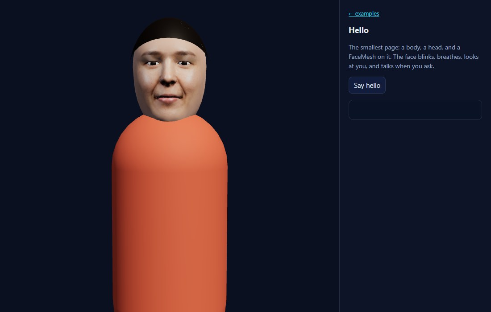
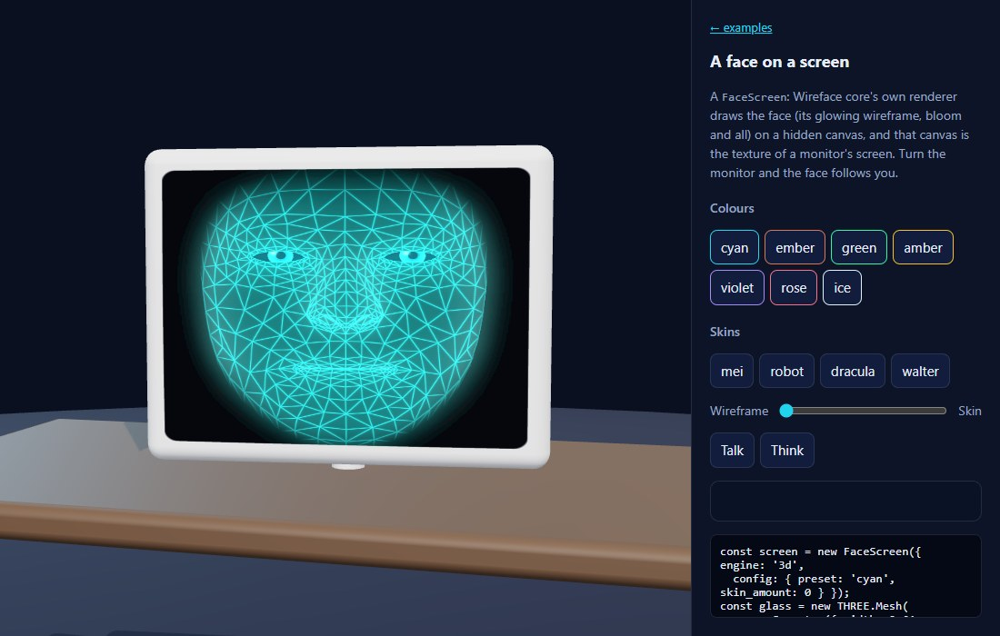
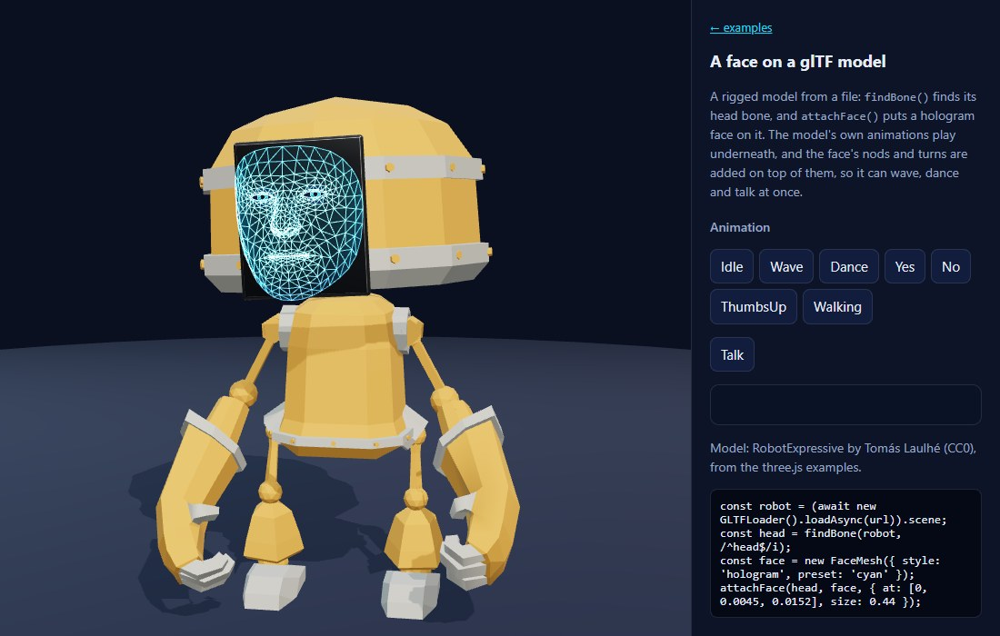
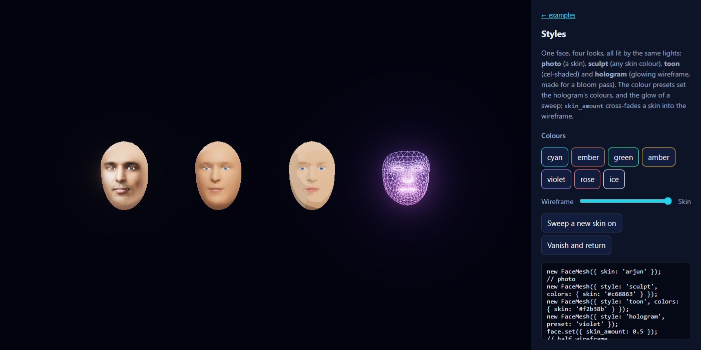

# Wireface SDK: three.js

How to put Wireface faces on three.js characters: what the two kinds of face are, how to fit one to a head, how to make
it talk, emote and look at things, and how to build characters of your own. For working code, see `examples/three/`; the
[Wireface Theatre](https://wireface.dev/threejs/demo/) puts the whole cast on one stage.

1. [Quick start](#1-quick-start)
2. [FaceMesh and FaceScreen](#2-facemesh-and-facescreen)
3. [Putting a face on a head](#3-putting-a-face-on-a-head)
4. [Motion and gaze](#4-motion-and-gaze)
5. [Speech](#5-speech)
6. [Expressions, moods and states](#6-expressions-moods-and-states)
7. [Looks](#7-looks)
8. [Building characters](#8-building-characters)
9. [Bundlers](#9-bundlers)
10. [Performance](#10-performance)
11. [Troubleshooting](#11-troubleshooting)
12. [Reference](#12-reference)
13. [Under the hood](#13-under-the-hood)

---

## 1. Quick start

```sh
npm install three github:compsmart/wireface-sdk#v0.1.0
```

`npm start` in the SDK's folder serves the examples at http://127.0.0.1:5173/examples/ (the three.js ones are in
`examples/three/`).



The smallest scene with a face (`examples/three/hello.html` is this, with a body):

```js
import * as THREE from 'three';
import { FaceMesh, attachFace, unlockAudio } from '@wireface/sdk/three';

const head = new THREE.Group();          // where the head goes: on a body, or on its own
head.position.y = 1.1;
scene.add(head);

const face = new FaceMesh({ skin: 'mei', size: 0.24 });   // 24 cm from chin to hairline
attachFace(head, face);
face.gazeAt(camera);

button.onclick = async () => {
  const audioContext = unlockAudio();    // browsers allow sound only after a click
  await face.say(await face.clip('mei'), { audioContext });
};
```

There is no loop to write. A FaceMesh updates itself as the scene renders: it reads the lip-sync timeline, runs the
animator, poses its vertices and turns its eyes. Render your scene as usual.

Pages that import these modules need an import map for `three` and `three/addons/`, or a bundler (section 9). With no
build step, map them from a CDN, along with the SDK's bundles so the code in this guide works as it is:

```html
<script type="importmap">
{ "imports": {
  "three": "https://cdn.jsdelivr.net/npm/three@0.186.1/build/three.module.js",
  "three/addons/": "https://cdn.jsdelivr.net/npm/three@0.186.1/examples/jsm/",
  "@wireface/sdk/three": "https://cdn.jsdelivr.net/gh/compsmart/wireface-sdk@v0.1.0/dist/three.js",
  "@wireface/sdk/three/characters": "https://cdn.jsdelivr.net/gh/compsmart/wireface-sdk@v0.1.0/dist/three-characters.js",
  "@wireface/sdk/three/kit": "https://cdn.jsdelivr.net/gh/compsmart/wireface-sdk@v0.1.0/dist/three-kit.js",
  "@wireface/sdk/2d/live": "https://cdn.jsdelivr.net/gh/compsmart/wireface-sdk@v0.1.0/dist/2d-live.js"
} }
</script>
```

`@wireface/sdk/three/characters` is the cast and `@wireface/sdk/three/kit` what it's made of (section 8);
`@wireface/sdk/2d/live` is for conversations (section 5).

---

## 2. FaceMesh and FaceScreen

There are two ways to show a Wireface face in a three.js scene.

**FaceMesh** rebuilds the face as three.js geometry. The 3D face's rig (MediaPipe's 468-point face mesh, sculpted
into 22 blend channels and a jaw) is posed on the CPU every frame, and its vertices go straight into a
`BufferGeometry`. It is lit by your lights, casts and receives shadows, is depth-sorted with everything else, and can be
seen from any side. Behind the face it builds the back of a head, and inside it the eyes, the mouth's cavity, teeth and
tongue. It adds no WebGL contexts, so you can have dozens.

**FaceScreen** runs a whole Wireface face (the 3D face's renderer, or Wireface 2D) on a hidden canvas, and gives you
that canvas as a `THREE.CanvasTexture`. It looks exactly as the engine draws it: the 3D face's hologram with its own
bloom, or a 2D picture (a painting, anime, pixel art) that talks. It's a picture on a surface, unlit, and each one is
its own WebGL context, of which a browser allows about sixteen.

Choose by what the face is *on*:

| A face that... | Use |
| --- | --- |
| is a head: a person, a creature, an alien, a robot's head | FaceMesh |
| is shown on something: a TV, a monitor, a helmet's visor, a painting | FaceScreen |
| is a 2D picture brought to life | FaceScreen with `engine: '2d'` |
| needs the 3D face's exact look, bloom and all | FaceScreen with `engine: '3d'` |
| comes in crowds | FaceMesh |

Both have the same methods (section 12), so code that drives one drives the other. What only a head has (`bounds`,
`head`, `skinMaterial()`, `drive()`) is FaceMesh's own.

### FaceScreen in four lines



```js
const screen = new FaceScreen({ engine: '3d', skin: 'robot', resolution: 512 });
const mesh = new THREE.Mesh(screenGeometry({ width: 0.6, height: 0.45, curve: 0.02 }), screen.material());
tv.add(screen.bind(mesh));           // the face is drawn whenever the mesh is
screen.gazeAt(camera);
```

- `resolution` is the canvas's size in pixels: a number, or `[width, height]` to match the surface's shape.
- `material({ background, brightness, corner, scanlines, vignette })` is an unlit screen material:
  - `background` is the colour behind the face, or `null` for see-through.
  - `corner` rounds the corners.
  - `scanlines` and `vignette` give an old set's glow.

  Any material whose `map` is `screen.texture` works too.
- `screenGeometry({ width, height, curve })` and `visorGeometry({ radius, width, height })` make surfaces that face +z
  with their texture the right way up. Any mesh with ordinary UVs will do.
- 2D options: `character` (an id from 2D's catalogue, or a picture) and `config` (2D's settings, such as
  `framing: 'cover'` to fill the surface, or `'face'` to close in on the face).
- 3D options: `skin`, `config` (the 3D face's settings) and `fit`.

The engine loads asynchronously. `await screen.ready` before reaching into `screen.face`, though the shared methods
wait for it themselves: `say`, `express` and the rest return a promise until it has loaded, and `listenTo` and `on`
return their stop function at once, and start as soon as it has. `dispose()` is safe before it has loaded: the engine
then never starts.

---

## 3. Putting a face on a head

### Size and the head's frame

A FaceMesh's own frame is the head's: its origin is the centre of the head, +z is the way it faces, +y is up, and +x is
the face's left (your right as you look at it). `size` is the face's height from chin to hairline in scene units, so
`size: 0.24` is a real person's 24 cm face in a scene in metres. The whole head, skull included, is about 1.3 times
that tall and 1.4 times that from nose to back. Stylised characters look good with big heads: the cast uses 0.25 to
0.3 on bodies about a metre tall.

### attachFace

```js
attachFace(head, face, { at: [0, 0.16, 0], rotation: [0, 0, 0], size: 0.27, motion: true });
```

- `head` is any `Object3D`: a group on your character's neck, a mesh, or a bone. Put its origin where the head should
  pivot, at the top of the neck.
- `at` places the face's centre in the head's space (here 16 cm above the neck).
- `rotation` is for heads whose front isn't +z, which is common for bones. The face's nods and turns then move the
  head on the face's own axes (a turn stays a turn, not a roll), whatever way the bone points.
- `size` is in *world* units, whatever scales the head has above it.
- `motion` (the default) makes the face move `head` with its sway, its nods while talking, and its turns towards what
  it looks at.

### bounds: where things are

`face.bounds` measures the head in its own frame, for placing things on it:

| | |
| --- | --- |
| `top`, `chin`, `brow` | heights: the hairline, the chin, the brows |
| `front`, `back` | the tip of the nose; the face's back edge (by the ears) |
| `skull` | `{ center, radius }`: the ellipsoid the back of the head is built on |
| `eyes` | `{ left, right, radius }` |
| `ears`, `nose`, `mouth`, `neck` | points |

```js
const { skull, eyes } = face.bounds;
hat.position.set(0, skull.center.y + skull.radius.y * 0.8, skull.center.z);
glasses.position.set(0, eyes.left.y, eyes.left.z + eyes.radius * 2.7);
face.head.add(hat, glasses);       // face.head moves with the face's own motion
```

Add hair, hats, glasses and ears to **`face.head`**, not the FaceMesh itself, and they move with every nod, whether the
face moves itself or an outside head.

### The skull, and heads of your own

`skull` controls the back of the head:
- `'auto'` (the default) gives one for the skin styles and none for a hologram.
- `true` or `false` forces it on or off.

`headShape: { width, height, depth, crown }` stretches the skull: `crown` raises the top of the head for a bigger
brain (Zib, in the cast).

To put a face on a head of your own (a pumpkin, a robot's dome, a ghost's sheet), turn the skull off and keep your
head *behind* the face. The face's eyes and mouth sit in hollows behind its surface, and anything in front of them hides
them. `bounds.back` is the plane to stay behind:

```js
const face = new FaceMesh({ style: 'hologram', preset: 'ember', skull: false, size: 0.24 });
face.position.set(0, 0.16, pumpkinRadius * 0.65);   // its back edge on the pumpkin's front
pumpkinHead.add(face);
face.drive(pumpkinHead);                             // its nods turn the pumpkin
```

### The head's colour

The skull, the face's edge, and any material from `face.skinMaterial()` wear `face.headColor`:
- With a photo skin, it's the skin tone read from the photo.
- Otherwise it's `colors.skin`.
- Set `headColor: '#rrggbb'` to choose it yourself.

Use `skinMaterial()` for ears, necks and hands: it keeps to the skin when the skin changes.

```js
const skin = face.skinMaterial({ roughness: 0.7 });
neck.material = skin;
hands.forEach(h => (h.material = skin));
```

### Rigged models (glTF)



```js
const gltf = await new GLTFLoader().loadAsync('robot.glb');
const head = findBone(gltf.scene, /^head$/i);                  // prefers a Bone to a mesh of the same name
attachFace(head, face, { at: [0, 0.0045, 0.0152], size: 0.44 });
mixer.update(dt);                                               // the model's animation, as usual
```

Bones are often in the model's own units (RobotExpressive's head bone is scaled 40 times), so `at` is in those and
`size` is in the world's. The face's motion is added *on top of* whatever your animation mixer does to the bone each
frame, so a model can wave, dance and talk at once. Run the mixer before rendering, as usual: the face adds its motion
as the scene renders and makes the bone's matrices again, so what's drawn (the bone, and a skinned mesh bound to it)
has both, that same frame. See `examples/three/attach-to-gltf.html`.

To copy a model with a face on it, use `SkeletonUtils.clone(model)` (from `three/addons/utils/SkeletonUtils.js`), as
for any rigged model. The copy gets a face of its own, made by `face.clone()`, and that face moves the copy's head.

---

## 4. Motion and gaze

A face is never still:
- it blinks, breathes and makes small gestures;
- its head sways a little;
- it nods and emphasises as it talks;
- a thinking face looks away, and a sleeping one drops its head.

This is the 3D face's animator, unchanged. The head motion goes to:
- the head you attached it to (`attachFace`, or `face.drive(object)`, for a head the face is on), added on top of that
  head's own rotation; or
- if there's no outside head, the face's own neck pivot.

`config.motion` (0 to 2) scales the sway, and `face.motion` holds the animator's head pose
(`{ yaw, pitch, roll, y }`) each frame, if you want to move something else with it.

### gazeAt

```js
face.gazeAt(camera);                          // an Object3D: followed as it moves
face.gazeAt(new THREE.Vector3(1, 1.5, 2));    // a point in world space
face.gazeAt(other.head, { turn: 0.4 });       // the head turns at most 0.4 rad; the eyes do the rest
face.gazeAt(null);                            // ahead
```

- **Eyes first.** The eyes take small angles, and converge on the target's distance.
- **Then the head.** Beyond about 12 degrees, the head turns too (up to `turn`, 0.9 radians by default), easing there
  like a person's.
- **Rest frame.** Angles are worked out in the head's frame before it turns, so they don't feed back on themselves.
- **Out of view.** Targets behind the head are ignored.

For a FaceScreen, `gazeAt` turns the face *inside* its picture (for 2D, the head turns a little; the eyes are the
picture's own). The cast's screen characters also turn their whole head (`Character.turnHead`).

---

## 5. Speech

### Recorded clips

A clip is audio plus a mouth track made by forced alignment from the audio *and its text*: the lips close on every m,
b and p and round on "oo", in time with the sound.

```js
const clip = await face.clip('dracula');                    // the 3D face's voices
const line = await face.clip('eleanor', voices('2d'));      // Wireface 2D's voices
await face.say(clip, { audioContext, onCaption: t => (caption.textContent = t) });
face.hush();                                                // stop
```

- **Folders.** `face.clip(id, folder)` loads `id.json` and `id.m4a` from any folder.
  - The 3D face has eight voices: amara, dracula, lucia, marcus, mei, monster, robot, walter.
  - Wireface 2D has thirteen, one per character.
- **Your own clips.** The tool that makes clips from your own audio comes with a
  [commercial licence](https://wireface.dev/license/). Any audio works with live audio or streamed speech, below.
- **Mime.** Without an `audioContext` a clip is mimed silently. That's handy for crowds, or for testing.
- **One at a time.** Starting a clip stops the one before it.
- **Cues.** To show expressions along a line, time them yourself, as the cast's `speak()` does from `cast.json`:

  ```js
  for (const [at, mood] of [[0, 'calm'], [2.2, 'amused']]) setTimeout(() => face.express(mood, 3), at * 1000);
  ```

### Live audio

```js
const stream = await navigator.mediaDevices.getUserMedia({ audio: true });
const stop = face.listenTo(audioContext, stream, { gain: 1.2 });
// ...
stop();
stream.getTracks().forEach(t => t.stop());        // and the microphone (the browser's recording light) off
```

`listenTo` reads the mouth from loudness and spectrum, frame by frame. It works with any MediaStream, an `<audio>` or
`<video>` element, or an AudioNode, so it covers microphones, WebRTC calls and streaming TTS played through an element.
Stopping it doesn't stop the stream: that's yours. To change the gain, stop it and listen again to the same stream
(`examples/three/mic.html` does), rather than asking the browser for the microphone again.

### Streamed speech and conversations

`StreamVoice` plays streamed PCM (from any realtime voice API) gaplessly, working the mouth out ahead of
playback. Wireface 2D's `Conversation` holds a whole Gemini Live conversation:
- it streams the replies;
- the model shows feelings through an `express` tool;
- `go_away` and `come_back` make the face vanish and return.

Both drive a FaceMesh as they drive their own faces:

```js
import { Conversation } from '@wireface/sdk/2d/live';
const talk = new Conversation(face, {
  audio: () => unlockAudio(),
  character: () => ({ name: 'Unit-7', voice: 'Puck', persona: 'You are Unit-7, a cheerful robot...' }),
  onCaption: ({ who, text }) => show(who, text),
});
await talk.start();
talk.setMic(true);
```

The browser asks a server for a one-use token, and the server holds the Gemini key. `npm start` in the SDK's folder
serves the 2D API (`/api/live/token` and the rest) when `GEMINI_API_KEY` is set (in the environment or `.env`). See
`examples/three/live-chat.html`, and [Servers and secrets](2d.md#10-servers-and-secrets) for serving it yourself.

### Events

`face.on(fn)` gets:
- `{ type: 'speaking', text }` when speech starts (`text: null` when it stops);
- `{ type: 'caption', text }` as each sentence reaches the listener;
- `{ type: 'skin', skin }` when a skin goes on (`skin` is its id, or null for a skin of your own) or comes off
  (`useSkin(null)`: `skin` is null).

`face.speaking` is true while it talks, and `face.level` (0 to 1) is how loudly, frame by frame. The cast uses `level`
for its talking gestures, Unit-7's lights and Zib's antennae.

---

## 6. Expressions, moods and states

```js
face.express('surprised', 3);    // for 3 seconds, over everything else
face.mood('content', 0.6);       // worn whenever nothing else is showing (null: none)
face.state('thinking');          // idle | thinking | busy | error | muted | asleep
```

- **Moods (`MOODS`).** neutral, happy, excited, amused, surprised, curious, thinking, concerned, sad, afraid,
  frustrated, calm, content, bored, glum.
- **Everyday names (`ALIASES`).** These work too: scared, worried, smile, laugh, angry, confused...
- **States.** These change the eyes and posture:
  - `thinking` looks up and away;
  - `asleep` closes the eyes and drops the head, breathing slowly;
  - `muted` dims the glow.

Make your own from the rig's channels (`CHANNELS`: smileL, smileR, browUpL, blinkR, squintL, sneer, pout, jaw, and the
rest):

```js
import { defineExpression } from '@wireface/sdk/three';
defineExpression('wink', { blinkL: 1, smileL: 0.45, smileR: 0.7, browUpR: 0.3 });
face.express('wink', 2);
```

This `defineExpression` reaches every face on the page, FaceScreens included. Wireface 2D has its own copy of the
animator, and this one writes to both.

---

## 7. Looks



| `style` | |
| --- | --- |
| `photo` | a skin: a picture plus where the 468 landmarks fall in it (the default when a skin is on) |
| `sculpt` | a shaded head in `colors.skin`, with lips, brows and cheeks tinted |
| `toon` | cel-shaded (three's MeshToonMaterial); with a skin on, a cel-shaded photo |
| `hologram` | the 3D face's glowing wireframe: a fresnel fill, lines, optional points, scanlines (the default with no skin) |

- **Skins.** The 3D face's catalogue has eleven: mei, marcus, amara, walter, lucia, arjun, omar, ruth, robot, monster,
  dracula. `skinFromPhoto(file)` makes one from any photo in the browser. Skins bring their teeth: the robot has
  braces, the monster sharp teeth, Dracula fangs.
- **Changing skin.** `useSkin(skin, { sweep: 1.4 })` scans the new skin down over the face. `useSkin(null)` takes it
  off.
- **`skin_amount`** (0 to 1) cross-fades a skin into the wireframe and glides to new values, so a slider can drive it.
- **Colours.** `preset` (cyan, ember, green, amber, violet, rose, ice) or `colors.primary`/`secondary` set the
  hologram's colours and the glow of a sweep. `glow`, `wire`, `fill`, `points`, `scanlines` and `edge_fade` tune it.
- **Bloom.** A hologram is light, and looks its best with a bloom pass (three's `UnrealBloomPass`) and something dark
  behind it, as Wisp's hollow and the glTF robot's face plate are.
- **Teeth.** `teeth_style` (normal, braces, vampire, goofy, sharp, turkey), `teeth_width` and `teeth_size`.
- **`disappear()` and `appear()`** burn the face away from the chin up and bring it back, with a hot edge. Both resolve
  when done. `setGone()` hides it at once. What you've added to the face or `face.head` (hair, ears, a hat) goes as
  the burn passes it, and comes back with the face.

All of the 3D face's settings work, checked the same way (an invalid one throws a `ConfigError` naming it), plus the
`toon` style. Pass them to the constructor, or to `set()` later:

```js
const face = new FaceMesh({ style: 'hologram', preset: 'violet', glow: 1.2, points: 0.4 });
face.set({ preset: 'ember' });
```

---

## 8. Building characters

Each member of the cast shows one idea (see [the cast](characters.md)). What they're made of is the kit,
`@wireface/sdk/three/kit` (also `kit` in `@wireface/sdk/three/characters`):

| | |
| --- | --- |
| `clay`, `vinyl`, `metal`, `cloth`, `glow`, `glass` | toy-figure materials |
| `part(geometry, material, at, { rotation, scale })` | a mesh that casts and receives shadows |
| `capsule`, `ball`, `box`, `tube`, `lathe`, `smoothLathe` | shapes |
| `hairCap(face, material, { cover, tilt, front })` | a cap of hair over a FaceMesh's skull, on `face.head` |
| `hairFall(face, material, { length, open })` | hair down the back and sides: a bob, or long |
| `ears(face, { size, point })` | ears at `bounds.ears`, in the skin's colour; `point` makes them elfin |
| `toyBody(character, { top, bottom, shoes, skin })` | legs, torso, arms and hands; returns the torso's top |
| `neck(character, skin, from, headY)`, `headAt(character, y)` | a neck, and the head group on it |
| `Character` | a figure's idle life and talking gestures, `gazeAt`, `speak()`, `update(dt, t)` |

A character, start to finish:

```js
import { FaceMesh, attachFace } from '@wireface/sdk/three';
import { Character, cloth, clay, hairCap, headAt, neck, toyBody, vinyl } from '@wireface/sdk/three/kit';

const c = new Character({ id: 'ana', name: 'Ana', height: 1.06, line: { engine: '3d', id: 'amara' } });
c.face = new FaceMesh({ skin: 'amara', size: 0.27 });
const skin = c.face.skinMaterial();
const { torsoTop } = toyBody(c, { top: cloth('#4f46e5'), bottom: cloth('#1f2937'), shoes: vinyl('#fafafa'), skin });
neck(c, skin, torsoTop - 0.03, torsoTop + 0.05);
attachFace(headAt(c, torsoTop + 0.03), c.face, { at: [0, 0.165, 0] });
hairCap(c.face, clay('#120c0a'), { front: 0.3 });

scene.add(c.root);
const timer = new THREE.Timer();
renderer.setAnimationLoop(time => { timer.update(time); c.update(timer.getDelta(), timer.getElapsed()); renderer.render(scene, camera); });
await c.speak({ audioContext });
```

`examples/three/custom-character.html` builds a snowman without the kit, from three.js primitives and `bounds`.

---

## 9. Bundlers

The SDK's bundles import `three` by name, and bundlers resolve it from `node_modules` with no settings. Two things need
care, as they do for the [3D face](guide.md#bundlers):

1. **Assets.** The skins, voices and 2D characters are found relative to the SDK's bundles. A bundler moves modules, so
   copy `node_modules/@wireface/sdk/assets` into your static folder and tell the faces where they are:

   ```js
   new FaceMesh({ skin: 'mei', assets: '/wireface/' });                 // the SDK's assets/ copied to public/wireface/
   setVoiceFolders({ '3d': '/wireface/voices/', '2d': '/wireface/2d/voices/' });
   new FaceScreen({ engine: '2d', assets: '/wireface/2d/', character: 'kit' });
   ```

2. **Vite.** Keep the SDK out of dependency pre-bundling, or the teeth images go missing in dev:

   ```js
   // vite.config.js
   export default { optimizeDeps: { exclude: ['@wireface/sdk'] } };
   ```

`voices()` looks for the recorded lines in the SDK's `assets/`, next to its bundles, where a bundler doesn't keep
them: bundled code should call `setVoiceFolders()` instead.

---

## 10. Performance

- **CPU.** A FaceMesh poses its 468 vertices on the CPU each frame. With its skull and mouth that's about 0.08 ms (a
  hologram about 0.03 ms), measured in Chrome on a desktop CPU, so a hundred faces cost about 8 ms a frame. Slower
  CPUs take longer: `examples/three/crowd.html` shows the frame rate as you add faces.
- **Memory.** Faces share what they can: the 3D face's skin list is fetched once per assets folder, and a skin's picture
  and a set of teeth are loaded and uploaded once, however many faces wear them. Each is freed when the last face using
  it changes skin or is disposed.
- **Draw calls.** A FaceMesh with a skin draws about eight meshes: face, skull, two eyes, cavity, two rows of teeth
  and the tongue. A hologram draws two or three, all additive.
- **Off-screen faces.** Faces update while they're in the scene graph, even out of view, because their head motion
  must go on. For faces far away, consider `autoUpdate: false`, and call `face.update()` yourself every few frames.
- **FaceScreens.** Each one draws its engine's frame and uploads the canvas as a texture every frame it's seen. Keep
  `resolution` to what the surface needs on screen, and keep to a handful: each is a WebGL context.
- **Shadows.** Faces cast and receive shadows (`shadows: false` to stop it). A small face needs a sharp shadow map to
  show its own shading: a `normalBias` of about 0.02 keeps it free of acne.

---

## 11. Troubleshooting

| Symptom | Cause |
| --- | --- |
| A face's eyes or mouth look hollow or hidden | Your head geometry is in front of the face. Keep it behind `bounds.back`, or use `skull: true` |
| A hologram is washed out or white | It's additive: put something dark behind it (a hollow, a plate), and use a bloom pass |
| No sound | Browsers start audio only from a gesture: call `unlockAudio()` in a click handler, and pass its context to `say()` |
| `the skin list not found at ...` | The assets aren't where the face looks: pass `assets` (section 9) |
| A FaceScreen is black | Its engine is still loading, or the browser is out of WebGL contexts (about sixteen a page) |
| The face doesn't move the head | Use `attachFace(head, face)` or `face.drive(head)`; a plain `head.add(face)` moves only the face |
| Things added to the face don't nod with it | Add them to `face.head`, not to the FaceMesh |
| Gaze points the wrong way on a bone | The bone's front isn't +z: pass `rotation` to `attachFace` |
| `ConfigError: unknown setting ...` | Settings are the 3D face's (snake_case, as in `face.json`) plus `style: 'toon'`; FaceMesh's own options are `size`, `skull`, `headShape`, `headColor`, `assets`, `autoUpdate`, `shadows` |

---

## 12. Reference

### FaceMesh

`new FaceMesh(options)` (or `createFaceMesh`) is a `THREE.Group`.

| Option | Default | |
| --- | --- | --- |
| `skin` | none | a catalogue id, or `{ image, landmarks, teeth? }` |
| `size` | `0.25` | the face's height, chin to hairline, in scene units |
| `skull` | `'auto'` | the back of the head: `'auto'`, `true`, `false` |
| `headShape` | `{}` | `{ width, height, depth, crown }` |
| `headColor` | `'auto'` | `'#rrggbb'`, or the photo's skin tone / `colors.skin` |
| `assets` | the SDK's | base URL of `skins/` and `voices/` |
| `autoUpdate` | `true` | update as the scene renders; `false`: call `update()` |
| `shadows` | `true` | cast and receive shadows |
| `config` | | a face config (the 3D face's `face.json`), merged with any settings given directly |
| any of the 3D face's settings | | `style`, `preset`, `colors`, `glow`, `teeth_style`, `motion`, `expressiveness`... |

| Method | |
| --- | --- |
| `say(clip, { audioContext, onCaption })` | speak a clip; resolves when done or stopped |
| `clip(id, folder?)` | load a clip (the 3D face's voices by default; `voices('2d')` for 2D's) |
| `hush()` | stop talking |
| `listenTo(audioContext, source, { gain })` | live lip sync; returns `stop()` |
| `express(name, seconds = 4)` | show an expression |
| `mood(name, intensity = 0.5)` | a standing mood, or `null` |
| `state(name)` | `idle`, `thinking`, `busy`, `error`, `muted`, `asleep` |
| `gazeAt(target, { turn = 0.9 })` | look at a Vector3 or Object3D, or `null` |
| `set(patch)` | change settings; returns the config |
| `useSkin(skin, { sweep, teeth })` | wear a skin (`null`: none) |
| `appear()`, `disappear()`, `setGone()` | come and go |
| `spinner(on = true)` | the waiting spinner in the eyes |
| `drive(object)` | move an outside head (one the face is on) with the face's motion (`null`: itself) |
| `setSize(size)` | resize |
| `skinMaterial(params)` | a MeshStandardMaterial in the head's colour, kept in step |
| `on(fn)` | events; returns an unsubscribe function |
| `update()` | one frame (automatic unless `autoUpdate: false`) |
| `clone()` | a new FaceMesh from the same options and its settings now (size, style, colours, skin), placed as this one is, with copies of what's been added to it; it drives the copy of the head this one drives once it's in the copied model (`SkeletonUtils.clone`). Changes to its own parts' materials aren't copied. `copy()` throws: a face can't be copied into another |
| `dispose()` | free geometries, materials and textures (shared ones once no other face uses them) |

| Property | |
| --- | --- |
| `config`, `style` | the settings; the style being shown |
| `bounds` | where things are on the head (section 3) |
| `head` | the group that moves with the face: add hair and hats to it |
| `headColor` | the skull's colour |
| `speaking`, `level` | talking; how loudly (0 to 1) |
| `motion` | the animator's head pose this frame |
| `ready` | resolves once the first skin is on |
| `view` | the `FaceDriver`: the 3D face's timeline, animator and rig |
| `surface`, `skullMesh`, `eyes`, `mouth` | the parts, for materials of your own (the skull keeps its material, and your changes to it, when the style changes) |
| `faceGeometry` | the face's own BufferGeometry, whose position attribute is the posed rig (not `geometry`, which would make three.js measure the group as a mesh) |

### FaceScreen

`new FaceScreen({ engine: '3d' | '2d', skin, character, config, resolution = 512, fit, assets, detect })`.

- **Properties.** `texture`, `canvas`, `face` (the engine's own: a `Wireface` for 3D, a `Wireface2D` for 2D), `config`
  (the engine's settings), and `ready` (resolves to the screen once loaded).
- **Methods.** `material(options)`, `bind(mesh)`, `update()` and `dispose()`, plus the same methods as FaceMesh:
  `say`, `clip`, `hush`, `listenTo`, `express`, `mood`, `state`, `set`, `gazeAt`, `appear`, `disappear`, `setGone`,
  `spinner` (3d), `useSkin` (3d), `useCharacter` (2d), `on`, `speaking` and `level`.

### Helpers

| | |
| --- | --- |
| `attachFace(head, face, { at, rotation, size, motion })` | add a face to a head and let it move it |
| `findBone(root, name)` | a bone by name (a RegExp or a string, any case) |
| `screenGeometry({ width, height, curve })`, `visorGeometry({ radius, width, height })` | surfaces for a FaceScreen |
| `unlockAudio()`, `audioContext()`, `onFirstGesture(fn)` | the page's AudioContext |
| `defineExpression(name, weights)` | an expression for every face |
| `voices(engine)`, `setVoiceFolders(map)` | where the recorded lines are |
| `validateFaceConfig(patch, base)`, `STYLES` | settings |
| `FaceDriver`, `STATES`, `Skull`, `headShape`, `outline`, `skinColour`, `irisColour` | the parts, to build on |

From the 3D face: `MOODS`, `EXPRESSIONS`, `ALIASES`, `CHANNELS`, `PRESETS`, `TEETH_STYLES`, `RANGES`, `DEFAULTS`,
`ConfigError`, `resolveExpression`, `catalogue`, `skinFromPhoto`, `loadClip`, `playClip`, `LiveLipSync`, `StreamVoice`,
`MouthTracker`, `ASSETS`.

From `@wireface/sdk/three/characters`: `CAST`, `buildCharacter(id, options)`, `Character`, and `kit` (section 8). A
`Character` has `update(dt, t)`, `gazeAt(target)`, `speak({ audioContext, onCaption })`, `hush()` (which also stops a
line that's still loading) and `dispose()` (the face, and the figure's geometries, materials and textures).

---

## 13. Under the hood

A FaceMesh runs the 3D face's rig, animator and lip-sync timeline without a canvas: its `FaceDriver`, in `face.view`.
Each frame it poses the rig straight into the face's geometry, turns the eyes, moves the mouth and the back of the head
with the jaw, eases between looks, and moves the head it drives. The skin styles are three.js's own lit materials, so
your lights and shadows fall on the face; the hologram is drawn additively. The back of the head is built from the
face's own outline, so no gap opens when the jaw drops.

A FaceScreen runs the 3D or 2D face on a canvas off the page, and draws and uploads a frame whenever the mesh it's
bound to is drawn.

`FaceDriver` has the shape the speech code expects of a face's `view` (`timeline`, `event()`), which is why
`playClip`, `LiveLipSync`, `StreamVoice` and 2D's `Conversation` drive a FaceMesh unchanged. It's the same animator, so
a face here moves exactly as it does in Wireface Desktop and on wireface.dev.
